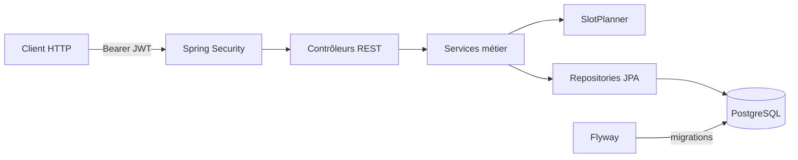
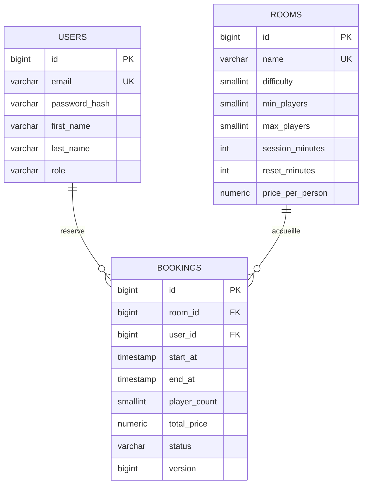

# 🕯️ Escape Game Booking API


API REST de réservation pour un escape game au thème horrifique : 4 salles, des créneaux calculés automatiquement, des comptes clients et un espace administrateur.

Projet personnel réalisé pour approfondir **Java** et **Spring Boot**, avec une attention particulière portée aux règles métier, à la sécurité et aux tests.

---

## Sommaire

- [Les salles](#-les-salles)
- [Fonctionnalités](#-fonctionnalités)
- [Stack technique](#-stack-technique)
- [Points techniques notables](#-points-techniques-notables)
- [Architecture](#-architecture)
- [Lancer le projet](#-lancer-le-projet)
- [Endpoints](#-endpoints)
- [Tests](#-tests)
- [Pistes d'évolution](#-pistes-dévolution)

---

## 🚪 Les salles

| Salle | Ambiance | Difficulté | Joueurs | Durée |
|---|---|---|---|---|
| **L'Asile de Saint-Ombre** | Hôpital psychiatrique abandonné | ★★★☆☆ | 2 à 5 | 60 min |
| **La Chambre des Poupées** | Nursery hantée | ★★☆☆☆ | 2 à 4 | 60 min |
| **Le Rituel** | Sous-sol d'une secte | ★★★★☆ | 3 à 6 | 60 min |
| **Laboratoire 13** | Expérience qui a mal tourné | ★★★★★ | 4 à 6 | 75 min |

Chaque salle a un temps de remise en état de 30 minutes entre deux sessions : les créneaux réservables en découlent automatiquement.

---

## ✨ Fonctionnalités

**Visiteurs**
- Consulter les salles
- Consulter les créneaux disponibles d'une salle pour une date donnée
- Créer un compte et se connecter (JWT)

**Clients connectés**
- Réserver un créneau
- Consulter et annuler leurs réservations (jusqu'à 24 h avant la session)

**Administrateurs**
- Consulter le planning de toutes les réservations d'une journée
- Annuler n'importe quelle réservation, à tout moment

**Règles métier appliquées**
- Le nombre de joueurs doit respecter les limites de la salle
- Un créneau doit tomber sur la grille de la salle et dans les horaires d'ouverture
- Réservation possible jusqu'à 60 jours à l'avance, jamais dans le passé
- Impossible de réserver deux fois le même créneau, même en cas de requêtes simultanées

---

## 🛠️ Stack technique

| Domaine | Technologies |
|---|---|
| Langage | Java 25 |
| Framework | Spring Boot 4.1 (Web MVC, Data JPA, Validation) |
| Sécurité | Spring Security, OAuth2 Resource Server (JWT signés HS256), BCrypt |
| Base de données | PostgreSQL 17, migrations Flyway |
| Documentation | OpenAPI / Swagger UI (springdoc) |
| Tests | JUnit 5, Mockito, AssertJ, MockMvc, Testcontainers |
| Outillage | Maven, Docker Compose, GitHub Actions |

---

## 💡 Points techniques notables

### Protection contre les doubles réservations
La réservation d'un créneau est protégée à **deux niveaux** :
1. **Côté application** : le service vérifie qu'aucune réservation confirmée ne chevauche le créneau demandé.
2. **Côté base de données** : une contrainte d'exclusion PostgreSQL rend tout chevauchement physiquement impossible, même si deux requêtes passent la vérification applicative au même instant.

```sql
CONSTRAINT bookings_no_overlap EXCLUDE USING gist (
    room_id WITH =,
    tsrange(start_at, end_at, '[)') WITH &&
) WHERE (status = 'CONFIRMED')
```

Un test d'intégration lance deux réservations simultanées du même créneau et vérifie qu'exactement une réussit (`201`) et l'autre est refusée (`409`).

### Modèle de domaine riche
Les entités protègent leur propre cohérence : une `Booking` calcule elle-même sa date de fin et son prix, et expose deux façons explicites de s'annuler (`cancel` pour le client, soumise au délai de 24 h, et `forceCancel` pour l'administrateur).

### Règles de planning centralisées
La grille des créneaux et la fenêtre de réservation sont définies dans un seul composant, `SlotPlanner`, utilisé à la fois pour valider une réservation et pour calculer les disponibilités. Le calendrier affiché ne peut donc jamais proposer un créneau que l'API refuserait.

### Horloge injectée
Le temps est fourni par un `Clock` injecté plutôt que par `LocalDateTime.now()`. Les tests unitaires figent ainsi « maintenant » à une date précise et vérifient les règles temporelles de façon déterministe.

### Erreurs standardisées
Toutes les erreurs suivent le format [RFC 9457 (Problem Details)](https://www.rfc-editor.org/rfc/rfc9457) :

```json
{
  "title": "Règle métier non respectée",
  "status": 422,
  "detail": "La salle « L'Asile de Saint-Ombre » accepte de 2 à 5 joueurs.",
  "instance": "/api/bookings"
}
```

| Code | Signification |
|---|---|
| `400` | Champs invalides (avec le détail par champ) |
| `401` | Non authentifié ou identifiants incorrects |
| `403` | Accès réservé aux administrateurs |
| `404` | Ressource introuvable, ou réservation appartenant à un autre client |
| `409` | Créneau déjà réservé, email déjà utilisé |
| `422` | Règle métier non respectée |

### Sécurité
- API **stateless** : aucune session côté serveur, chaque requête porte son jeton JWT.
- L'identité du client est toujours lue dans le jeton, jamais dans le corps de la requête : impossible de réserver au nom de quelqu'un d'autre.
- Un client qui tente d'accéder à la réservation d'un autre reçoit un `404` plutôt qu'un `403`, pour ne pas révéler son existence.
- Mots de passe hachés avec BCrypt ; secrets fournis par variables d'environnement.

---

## 🧱 Architecture



Le code est organisé **par fonctionnalité** :

```
src/main/java/.../
├── auth/          inscription, connexion, génération des JWT
├── availability/  calcul des créneaux disponibles
├── booking/       réservations, règles métier, planning des créneaux
├── room/          salles
├── user/          comptes utilisateurs, création du compte admin
├── config/        sécurité, propriétés, horloge, OpenAPI
└── common/        exceptions et gestion globale des erreurs
```

### Modèle de données



---

## 🚀 Lancer le projet

### Prérequis
- JDK 25
- Docker (Docker Desktop sous Windows et macOS)

### Démarrage

```bash
git clone https://github.com/Maudilama/escape-game-booking.git
cd escape-game-booking
./mvnw spring-boot:run
```

Sous Windows : `.\mvnw.cmd spring-boot:run`

La base PostgreSQL est démarrée automatiquement via Docker Compose, et Flyway crée le schéma ainsi que les 4 salles.

- API : http://localhost:8080
- **Documentation interactive (Swagger UI) : http://localhost:8080/swagger-ui.html**

### Compte administrateur de développement

Un compte administrateur est créé au premier démarrage :

| Email | Mot de passe |
|---|---|
| `admin@escapegame.local` | `admin-local-1234` |

Ces valeurs ne servent qu'en local. En production, elles sont remplacées par les variables d'environnement `ADMIN_EMAIL`, `ADMIN_PASSWORD` et `JWT_SECRET`.

### Exemple de parcours

```bash
# 1. Créer un compte
curl -X POST http://localhost:8080/api/auth/register \
  -H "Content-Type: application/json" \
  -d '{"email":"alice@example.com","password":"motdepasse123","firstName":"Alice","lastName":"Martin"}'

# 2. Se connecter et récupérer le jeton
curl -X POST http://localhost:8080/api/auth/login \
  -H "Content-Type: application/json" \
  -d '{"email":"alice@example.com","password":"motdepasse123"}'

# 3. Consulter les créneaux d'une salle
curl "http://localhost:8080/api/rooms/1/availability?date=2026-12-05"

# 4. Réserver
curl -X POST http://localhost:8080/api/bookings \
  -H "Authorization: Bearer <jeton>" \
  -H "Content-Type: application/json" \
  -d '{"roomId":1,"startAt":"2026-12-05T11:30:00","playerCount":4}'
```

---

## 📡 Endpoints

| Méthode | Route | Accès | Description |
|---|---|---|---|
| `GET` | `/api/rooms` | Public | Liste des salles |
| `GET` | `/api/rooms/{id}` | Public | Détail d'une salle |
| `GET` | `/api/rooms/{id}/availability?date=` | Public | Créneaux d'une journée |
| `POST` | `/api/auth/register` | Public | Création de compte |
| `POST` | `/api/auth/login` | Public | Connexion, renvoie un JWT |
| `POST` | `/api/bookings` | Client | Réserver un créneau |
| `GET` | `/api/bookings/me` | Client | Mes réservations |
| `GET` | `/api/bookings/{id}` | Propriétaire ou admin | Détail d'une réservation |
| `PATCH` | `/api/bookings/{id}/cancel` | Propriétaire ou admin | Annuler une réservation |
| `GET` | `/api/admin/bookings?date=` | Admin | Planning du jour |

Le détail complet (schémas, exemples, codes de retour) est disponible dans Swagger UI.

---

## 🧪 Tests

```bash
./mvnw test
```

Docker doit être lancé : les tests d'intégration démarrent leur propre PostgreSQL jetable avec **Testcontainers**.

| Type | Ce qui est vérifié |
|---|---|
| **Unitaires** (JUnit, Mockito) | Règles métier des réservations, grille des créneaux, fenêtre de réservation, droits d'accès, avec une horloge figée |
| **Intégration** (MockMvc, Testcontainers) | Application complète sur un vrai PostgreSQL : sécurité, parcours de réservation, contrainte d'exclusion, réservations simultanées |

Les tests sont exécutés automatiquement par **GitHub Actions** à chaque push et à chaque pull request.

---

## 🔭 Pistes d'évolution

- [ ] Interface web en React / TypeScript
- [ ] Gestion des salles par l'administrateur (création, modification, désactivation)
- [ ] Email de confirmation de réservation
- [ ] Jetons de rafraîchissement (refresh tokens)
- [ ] Paiement en ligne
- [ ] Image Docker de l'application et déploiement

---

## 👤 Autrice

**Marie-Aude Torchy**, développeuse fullstack à Nantes

[LinkedIn](www.linkedin.com/in/marie-aude-torchy-04300b123) · [GitHub](https://github.com/Maudilama)
